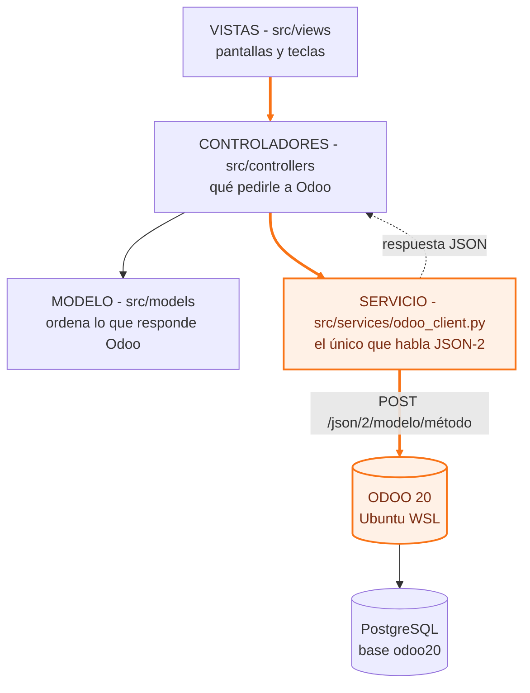
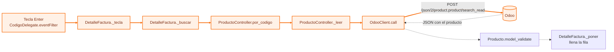
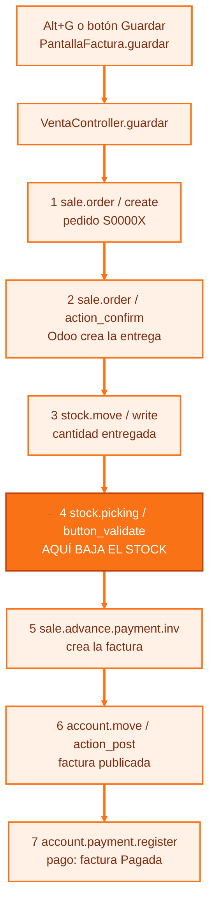

# Guía del código: cómo viaja una consulta y una venta hasta Odoo

Para entender y editar la app. Los caminos van en **naranja** en los diagramas, y los links
llevan a la línea exacta en GitHub.

**En el código, cada línea de un camino tiene al final una marca 🟠** con el mismo nombre y
número que esta guía. Para verlas todas de una vez, en VS Code: **Ctrl+Shift+F** y buscar `🟠`
(o `🟠 VENTA`, `🟠 CONSULTA`…).

| Marca en el código | Camino |
|---|---|
| `# 🟠 CONSULTA 1` … `# 🟠 CONSULTA 8` | Escribir un código + Enter, hasta que la fila se llena (sección 1) |
| `# 🟠 CONSULTA F9` | Buscar en el Maestro de Artículos |
| `# 🟠 VENTA 0` … `# 🟠 VENTA 7` | Alt+G: pedido, entrega (**VENTA 4: aquí baja el stock**), factura y pago (sección 2) |
| `# 🟠 LOGIN 1` … `# 🟠 LOGIN 4` | Entrar a la app (sección 3) |
| `# 🟠 TABLA` | La DataTable del jefe y sus ajustes (sección 4) |
| `# 🟠 EL POST A ODOO (JSON-2)` | La única línea que manda datos a Odoo |

## 0. Mapa del proyecto (MVC)



| Archivo | Qué hace |
|---|---|
| `main.py` | Arranque: lee `.env`, login, abre la ventana |
| `src/services/odoo_client.py` | **Toda** la comunicación con Odoo: arma el POST JSON-2, pone la clave API, devuelve la respuesta o un error claro |
| `src/controllers/producto_controller.py` | Búsquedas de productos (`product.product`) y % de IVA (`account.tax`) |
| `src/controllers/venta_controller.py` | Guardar: pedido → entrega (baja el stock) → factura → pago |
| `src/models/producto.py` | Convierte un producto de Odoo en un objeto `Producto` (Pydantic) |
| `src/views/detalle_factura.py` | **La tabla de la factura** (la `DataTable` que dio el jefe) y sus teclas |
| `src/views/factura_datatable_view.py` | La pantalla que contiene la tabla: buscador, totales, Guardar, Alt+G |
| `src/views/articulos_dialog.py` | Ventana F9 (Maestro de Artículos) |
| `src/views/login_view.py` | Ventana de login |
| `src/views/factura_view.py` | Factura anterior (grilla de 10 filas), respaldo |
| `scripts/cargar_inventario.py` | Carga 8 productos de prueba con stock |

Regla de oro: **las vistas nunca hablan con Odoo**. Llaman a un controlador, el controlador
llama a `odoo.call(...)`, y solo `odoo_client.py` hace el POST.

---

## 1. Camino de una CONSULTA: escribir `4.5` y presionar Enter



| Paso | Archivo y línea | Qué pasa |
|---|---|---|
| 🟠 1 | [detalle_factura.py:86](https://github.com/Tickey0/PYSIDE6_ODOO/blob/7ed66ad/src/views/detalle_factura.py#L86) `CodigoDelegate.eventFilter` | Atrapa Enter en la celda del código y emite `("buscar", "4.5")` |
| 🟠 2 | [detalle_factura.py:282](https://github.com/Tickey0/PYSIDE6_ODOO/blob/7ed66ad/src/views/detalle_factura.py#L282) `_tecla` | Decide qué hacer según la tecla |
| 🟠 3 | [detalle_factura.py:301](https://github.com/Tickey0/PYSIDE6_ODOO/blob/7ed66ad/src/views/detalle_factura.py#L301) `_buscar` | `separar_cantidad("4.5")` → cantidad **4**, código **5**. Pide el código exacto ([línea 309](https://github.com/Tickey0/PYSIDE6_ODOO/blob/7ed66ad/src/views/detalle_factura.py#L309)); si no hay, busca por nombre ([línea 315](https://github.com/Tickey0/PYSIDE6_ODOO/blob/7ed66ad/src/views/detalle_factura.py#L315)) |
| 🟠 4 | [producto_controller.py:35](https://github.com/Tickey0/PYSIDE6_ODOO/blob/7ed66ad/src/controllers/producto_controller.py#L35) `por_codigo` | Arma el filtro: código de barras **o** referencia igual a `5` |
| 🟠 5 | [producto_controller.py:23](https://github.com/Tickey0/PYSIDE6_ODOO/blob/7ed66ad/src/controllers/producto_controller.py#L23) `_leer` | Agrega `DOMINIO_BASE` (solo bienes, vendibles y del PdV) y llama a Odoo |
| 🟠 6 | [odoo_client.py:49](https://github.com/Tickey0/PYSIDE6_ODOO/blob/7ed66ad/src/services/odoo_client.py#L49) `call` | **Aquí sale el POST a Odoo** ([línea 57](https://github.com/Tickey0/PYSIDE6_ODOO/blob/7ed66ad/src/services/odoo_client.py#L57)) |
| 7 | [producto.py:6](https://github.com/Tickey0/PYSIDE6_ODOO/blob/7ed66ad/src/models/producto.py#L6) `Producto` | Convierte la respuesta: `uom_id [1, "Unidades"]` → `"Unidades"` |
| 8 | [detalle_factura.py:339](https://github.com/Tickey0/PYSIDE6_ODOO/blob/7ed66ad/src/views/detalle_factura.py#L339) `_poner` | Pone el producto en la fila y salta a la fila en blanco |

El corazón, `OdooClient.call` en `src/services/odoo_client.py` (resumido, sin el manejo de errores):

```python
def call(self, model, method, ids=None, **kwargs):
    body = dict(kwargs)                       # 🟠 los argumentos van CON NOMBRE: domain=, fields=...
    if ids is not None:
        body["ids"] = ids                     # 🟠 sobre qué registros (para read, write, action_...)
    if self.context:
        body.setdefault("context", self.context)   # idioma es_EC, zona horaria
    r = self.http.post(f"{self.url}/json/2/{model}/{method}", json=body)   # 🟠 EL POST A ODOO
    if r.status_code == 200:
        return r.json()                       # 🟠 lo que devuelve el método de Odoo, en JSON
```

La cabecera de **cada** llamada (se pone una sola vez en `__init__`):

```
Authorization: bearer <clave API del .env>
X-Odoo-Database: odoo20
```

### El JSON real de este paso

Lo que la app **manda** (`POST http://127.0.0.1:8069/json/2/product.product/search_read`):

```json
{
  "domain": [["sale_ok", "=", true], ["type", "=", "consu"], ["available_in_pos", "=", true],
             "|", ["barcode", "=", "5"], ["default_code", "=", "5"]],
  "fields": ["id", "display_name", "barcode", "default_code", "lst_price", "uom_id", "qty_available", "taxes_id"],
  "limit": 2,
  "order": "name",
  "context": {"lang": "es_EC", "tz": "America/Guayaquil", "display_default_code": false}
}
```

Lo que Odoo **responde**:

```json
[{"id": 9, "display_name": "CHOCOLATE LISTO 220GR", "barcode": "7861000000059", "default_code": "5",
  "lst_price": 1.54, "uom_id": [1, "Unidades"], "qty_available": 28.0, "taxes_id": [1]}]
```

`taxes_id: [1]` es el impuesto 15%. El controlador lo traduce a porcentaje con
`account.tax/search_read` (una sola vez, [línea 15](https://github.com/Tickey0/PYSIDE6_ODOO/blob/7ed66ad/src/controllers/producto_controller.py#L15)).

**F9** hace el mismo camino, pero por [`ArticulosDialog.buscar`](https://github.com/Tickey0/PYSIDE6_ODOO/blob/7ed66ad/src/views/articulos_dialog.py#L70)
→ `ProductoController.buscar` → `OdooClient.call`.

---

## 2. Camino de una VENTA: Alt+G (Guardar)



| Paso | Archivo y línea | Llamada JSON-2 | Qué hace Odoo |
|---|---|---|---|
| 🟠 0 | [factura_datatable_view.py:204](https://github.com/Tickey0/PYSIDE6_ODOO/blob/7ed66ad/src/views/factura_datatable_view.py#L204) `guardar` | — | Revisa stock, pide confirmación y llama al controlador ([línea 231](https://github.com/Tickey0/PYSIDE6_ODOO/blob/7ed66ad/src/views/factura_datatable_view.py#L231)) |
| 🟠 | [venta_controller.py:31](https://github.com/Tickey0/PYSIDE6_ODOO/blob/7ed66ad/src/controllers/venta_controller.py#L31) | `res.partner/search` (y `create` la 1ra vez) | Busca el cliente CONSUMIDOR FINAL (9999999999999) |
| 🟠 1 | [venta_controller.py:55](https://github.com/Tickey0/PYSIDE6_ODOO/blob/7ed66ad/src/controllers/venta_controller.py#L55) | `sale.order/create` | Crea el **pedido** con las líneas (producto, cantidad, precio) |
| 🟠 2 | [venta_controller.py:69](https://github.com/Tickey0/PYSIDE6_ODOO/blob/7ed66ad/src/controllers/venta_controller.py#L69) | `sale.order/action_confirm` | Confirma el pedido y **crea la entrega** `WH/OUT/...` |
| 🟠 3 | [venta_controller.py:78](https://github.com/Tickey0/PYSIDE6_ODOO/blob/7ed66ad/src/controllers/venta_controller.py#L78) | `stock.move/write` | Marca cuánto se entrega de cada producto |
| 🟠 4 | [venta_controller.py:80](https://github.com/Tickey0/PYSIDE6_ODOO/blob/7ed66ad/src/controllers/venta_controller.py#L80) | `stock.picking/button_validate` | **Valida la entrega: aquí baja el stock** |
| 🟠 5 | [venta_controller.py:88](https://github.com/Tickey0/PYSIDE6_ODOO/blob/7ed66ad/src/controllers/venta_controller.py#L88) | `sale.advance.payment.inv/create` + `create_invoices` | Crea la **factura** desde el pedido |
| 🟠 6 | [venta_controller.py:95](https://github.com/Tickey0/PYSIDE6_ODOO/blob/7ed66ad/src/controllers/venta_controller.py#L95) | `account.move/action_post` | **Publica** la factura (`INV/2026/...`) |
| 🟠 7 | [venta_controller.py:100](https://github.com/Tickey0/PYSIDE6_ODOO/blob/7ed66ad/src/controllers/venta_controller.py#L100) | `account.payment.register/create` + `action_create_payments` | Registra el **pago** (diario Efectivo, o Banco si no hay) |

El JSON del paso 1 (lo que se manda a `POST /json/2/sale.order/create`), con 4 chocolates:

```json
{
  "vals_list": [{
    "partner_id": 7,
    "fiscal_position_id": false,
    "order_line": [[0, 0, {"product_id": 9, "product_uom_qty": 4, "price_unit": 1.54}]]
  }],
  "context": {"lang": "es_EC", "tz": "America/Guayaquil"}
}
```

- `[0, 0, {...}]` es la forma de Odoo de decir "crea esta línea nueva".
- `fiscal_position_id: false` evita que Odoo cambie el 15% por "0% Exports" (la empresa está en EE.UU.).
- Odoo responde una lista con el id del pedido nuevo, por ejemplo `[5]`.

**Importante:** cada llamada JSON-2 es una transacción aparte. Si Odoo falla en el paso 5, los
pasos 1–4 ya quedaron guardados. Por eso el error dice *"Ya quedó hecho en Odoo: …"*
([línea 107](https://github.com/Tickey0/PYSIDE6_ODOO/blob/7ed66ad/src/controllers/venta_controller.py#L107)).
La mejora a futuro es un módulo de Odoo con un solo método que haga todo junto.

---

## 3. Camino del LOGIN

| Paso | Archivo y línea | Qué pasa |
|---|---|---|
| 🟠 1 | [main.py:62](https://github.com/Tickey0/PYSIDE6_ODOO/blob/7ed66ad/main.py#L62) `main` | Lee `.env` (`OdooClient.desde_env`) y prueba `GET /web/version` |
| 🟠 2 | [main.py:50](https://github.com/Tickey0/PYSIDE6_ODOO/blob/7ed66ad/main.py#L50) `iniciar_sesion` | Muestra el login (admin/admin) |
| 🟠 3 | [odoo_client.py:70](https://github.com/Tickey0/PYSIDE6_ODOO/blob/7ed66ad/src/services/odoo_client.py#L70) `login` | `POST /web/session/authenticate`: valida usuario y contraseña |
| 🟠 4 | mismo método | `POST /json/2/res.users/context_get`: Odoo dice **de quién es la clave API**. Si no es del mismo usuario, no entra |

JSON-2 **no acepta** usuario y contraseña, solo la clave API. Por eso el login valida la
contraseña aparte y comprueba que la clave sea del mismo usuario.

---

## 4. La tabla del jefe (`table/app.py`): cómo se llama ahora

El ejemplo `table/app.py` usa la librería **`pyside6-datatable-widget`** (`from datatable import DataTable`).
Ahora está en **`src/views/detalle_factura.py`**, clase **`DetalleFactura`**. La usa la pantalla
`src/views/factura_datatable_view.py` (clase `PantallaFactura`), que hace de contenedor.

**El archivo `table/app.py` del jefe no se modificó**, y la librería tampoco: se instala con pip
y solo se configura desde `detalle_factura.py`.

| En `table/app.py` del jefe | En `src/views/detalle_factura.py` |
|---|---|
| `self.data_table = DataTable()` | `self.tabla = DataTable()` ([línea 125](https://github.com/Tickey0/PYSIDE6_ODOO/blob/7ed66ad/src/views/detalle_factura.py#L125)) |
| `_filterState.itemsPerPage = 1000` | `getFilterStateInstance().itemsPerPage = 100_000` (sin paginación) |
| `setColumns([("id","ID",DataType.STRING), ...])` | `setColumns(...)` con las 10 columnas de la factura (lista `COLUMNAS`) |
| `setEditableColumns({"id": True})` | `setEditableColumns({"codigo": True})`: solo se edita el código |
| `setData(data)` con datos fijos | `getModelInstance().setModelData(filas)` con los productos de Odoo ([línea 220](https://github.com/Tickey0/PYSIDE6_ODOO/blob/7ed66ad/src/views/detalle_factura.py#L220)) |
| Enter agrega una fila vacía | Enter **busca el producto en Odoo**, llena la fila y salta a la fila en blanco |
| Shift+F6 **borra** la fila (`del model._data[row]`) | Shift+F6 **vacía** la fila y la deja para reescribir ([línea 294](https://github.com/Tickey0/PYSIDE6_ODOO/blob/7ed66ad/src/views/detalle_factura.py#L294)) |

Lo que hubo que ajustarle a la librería (todo en [`_preparar_vista`](https://github.com/Tickey0/PYSIDE6_ODOO/blob/7ed66ad/src/views/detalle_factura.py#L146)):

| La librería traía | Problema | Ajuste |
|---|---|---|
| Buscador y paginación | Filtran filas y esconden la fila en blanco | Se esconden (`_esconder_controles`) |
| Orden por la 1ra columna, de mayor a menor | Las filas salían al revés | `getProxyModelInstance().sort(-1)` |
| Filas alternadas | Azul marino con Windows en modo oscuro | `setAlternatingRowColors(False)` |
| Tamaño mínimo 640x480 | La parte de abajo tapaba la tabla | `setMinimumSize(0, 0)` |
| `setData()` devuelve el scroll a donde estaba | El scroll no bajaba | Se usa `setModelData()` directo |
| Columnas de 45 px mínimo y ancho fijo | Barra horizontal en ventanas chicas | `_ajustar_columnas`: el ancho se reparte según la ventana |

---

## 5. Recetas para editar

| Quiero… | Dónde |
|---|---|
| Que aparezcan otros productos (ej. también servicios) | `DOMINIO_BASE` en [producto_controller.py:5](https://github.com/Tickey0/PYSIDE6_ODOO/blob/7ed66ad/src/controllers/producto_controller.py#L5) |
| Traer otro campo de Odoo (ej. `categ_id`) | Agregarlo a `CAMPOS` y como campo en `src/models/producto.py` |
| Agregar o cambiar una columna de la factura | Lista `COLUMNAS` y diccionario de `_refrescar` en `detalle_factura.py` |
| Cambiar qué columnas crecen más | `PESOS` en `detalle_factura.py` |
| Cambiar una tecla de la tabla | `CodigoDelegate.eventFilter` en `detalle_factura.py` |
| Cambiar Alt+G o Ctrl+F | `PantallaFactura.__init__` y `_atajo_alt` en `factura_datatable_view.py` |
| Cambiar qué crea Guardar en Odoo | `VentaController.guardar` en `venta_controller.py` |
| Cambiar el diario del pago | `_diario_pago` en `venta_controller.py` |
| Volver a la factura anterior (10 filas) | Comentario al inicio de `main.py` |
| Llamar a cualquier otro método de Odoo | `odoo.call("modelo", "método", ids=[...], argumento=valor)` |

Reglas de JSON-2 que conviene recordar:
- Los argumentos van **con nombre**: `domain=`, `fields=`, `vals_list=`, `vals=`. No por posición.
- `ids=[...]` indica sobre qué registros actúa el método (`read`, `write`, `action_post`…).
- Error **401** = la clave API no sirve o venció: crear otra en Odoo y pegarla en `.env`.
- Solo se pueden llamar métodos públicos (los que no empiezan con `_`).
